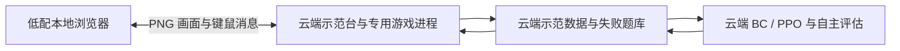

# 无桌面云端运行与浏览器示范台

> 0.4 新增：远程采集延迟较高时，优先用 [Windows 本机录制](windows-capture.md)。游戏在 Windows 运行，Linux 只接收题包/示范并训练。以下保留原云端入口。

更新：2026-11-26，0.3 版。本地低配、无 GPU，只承担开发、SSH 和浏览器操作；地图渲染、示范保存、训练与评估放在 Ubuntu 22.04/24.04 x86_64 云端。已确认平台为矩池云、GPU 为 NVIDIA、可使用 sudo；具体 GPU 型号、镜像和实例图形能力仍需核验。首次上云先看[矩池云操作指南](matpool.md)，本页说明通用工具与采集流程。

## 1. 已实现的入口与边界

希望先连续试玩、直接中文选关，可使用独立的[实时试玩入口](desktop-trial.md)。它运行上游关卡，不采集训练示范；下面的路线引导和正式录制属于原有逐帧示范台，两种入口不能混用质量门槛或数据说明。

### 首次试玩：先看懂路线，再录示范

网页默认选择“先熟悉路线 · 带引导练习”。加载后可看到路线示意：白箭头是当前位置与朝向，黄色编号点是下一目标，青色圈是终点。游戏画面上方同时提示转向和到下一点的距离；依次进入路线点的判定范围，进度由引擎更新。路线图没有墙体轮廓，连线不是避障导航，遇墙仍需沿通道绕行。

“01 · 路线行走”没有敌人，不需要开枪；依次经过 5 个路线点，最后到达 A 入口。其他课程仍需满足各自的交战要求，走完路线不一定立即成功。

带引导练习不会创建示范文件，也不会把纠错任务标为已示范。熟悉路线后结束练习，切换“正式示范 · 无额外导航”，重新加载场景，再开始录制。正式模式不发送位置、路线和朝向引导信息，保存的画面仍是原始游戏 RGB。练习导航是网页独立绘制的辅助信息，没有改动地图、奖励、观察尺寸或模型输入。

限制：该引导尚不是游戏内的 3D 路标或完整小地图；没有自动绕墙寻路。云端更新后仍需要真人确认实际路线可走、提示方向与画面相符。

| 功能 | 当前状态 |
| --- | --- |
| 云端依赖与诊断 | `setup_cloud.sh`、`python -m valorant_lab.cloud check`；分别报告 NVIDIA 设备和实际 OpenGL 渲染 |
| 无显示器 GPU 会话 | 独立 NVIDIA Xorg 配置、私有 Xauthority、自动检查；只清理自己启动的显示进程 |
| 中文浏览器示范台 | `web` 命令；五个课程、失败题库、鼠标锁定、移动/开枪/换弹、确认提交 |
| 画面与动作对齐 | 无损 PNG + WebSocket；当前画面展示确认后才接受对应动作，不执行旧帧动作队列 |
| 质量控制 | 失焦、断线、超时、过期画面、未成功或未确认的示范不进入普通 BC |
| 学习衔接 | 沿用示范格式、BC/PPO 与开发评估；提交后需运行下一次训练，不会即时改变模型 |
| 真实云端验收 | 尚未执行；当前没有目标服务器连接信息，不宣称 GPU 加速或公网手感已通过 |



模型与游戏同机运行，不经浏览器转发动作；无人训练时可关闭浏览器。首版每个示范台允许一个人工控制连接，人工与训练进程各自拥有引擎，优先分时使用 GPU。离线 BC 不需要渲染；仅适合 CUDA 计算的实例也可以承担它。当前 PPO 尚无跨主机 rollout 服务。

## 2. 云服务器软件准备

先完成 [README](../README.md) 的克隆、`setup_ubuntu.sh`、地图安装与引擎构建，再在仓库根目录执行：

```bash
source .venv/bin/activate
bash scripts/setup_cloud.sh
python -m valorant_lab.cloud check --output runs/cloud-check.json
```

脚本安装 Xorg 核心、xauth、glxinfo 和浏览器服务依赖，不安装完整桌面，也不安装、替换 NVIDIA 驱动。平台应事先提供可工作的图形驱动与 Xorg NVIDIA 模块。尚未启动显示时 `graphics.ok=false` 是预期状态；`check --require-gpu` 会在图形检查不通过时返回失败，适合正式启动前使用。

平台品牌不改变算法，但实例权限和驱动能力影响图形进程。容器 sudo 不等于宿主机权限；`nvidia-smi` 或 PyTorch CUDA 成功不能证明 OpenGL 可用。NVIDIA 区分 `compute`、`utility`、`graphics`、`display`、`video` 能力，默认容器可能只启用前两项。设备和能力需由平台/宿主机配置，不能只在运行中的容器添加环境变量补齐。[NVIDIA 官方说明](https://docs.nvidia.com/datacenter/cloud-native/container-toolkit/latest/docker-specialized.html)

首版 PNG 通道不依赖 NVENC；未来接视频串流时再核验编码能力。24–100 GB 显存只是训练预算，不代表图形能力已通过。

## 3. 启动 GPU 图形会话

**普通账号＋sudo：推荐分开运行显示服务和训练。** 终端 A 在仓库目录执行并保持存活：

```bash
sudo .venv/bin/python -m valorant_lab.cloud display --display 99
```

脚本使用 GPU 0，打印 `DISPLAY` 和 `XAUTHORITY` 路径。终端 B 保持普通账号，复制打印出的实际路径：

```bash
source .venv/bin/activate
export DISPLAY=:99
export XAUTHORITY=/实际仓库路径/runs/gpu-display-实际编号/Xauthority
python -m valorant_lab.cloud check --require-gpu
bash scripts/run_cloud.sh smoke
```

使用其他 GPU 时在显示命令加 `--gpu 1`。显示号被占用会拒绝启动，应换空闲编号，不删除已有锁文件。已有 NVIDIA `DISPLAY` 可直接复用。

**平台默认 root 登录：** 无 `DISPLAY` 时直接 `bash scripts/run_cloud.sh smoke` 或 `bash scripts/run_cloud.sh web`，启动器自动选择空闲显示号 90–119，为这条命令创建 GPU Xorg；命令退出后关闭自己的显示进程。普通账号无显示时会提示先用 sudo 显示命令。`VALORANT_LAB_GPU=1` 可选择另一张卡；复用显示时以该显示的 GPU 为准。

配置使用 `AllowEmptyInitialConfiguration`，不修改 `/etc/X11`，不接管已有桌面。数据中心 GPU 的虚拟显示模式不支持旧的 `UseDisplayDevice=none`，因此不强制该选项。检查同时使用 OpenGL vendor 和 renderer，允许 V100 的 renderer 仅显示 `Tesla V100...`，仍拒绝软件渲染。实例仍可能因驱动、设备或虚拟终端权限拒绝启动；检查 `runs/gpu-display-*/Xorg.log` 和 `launcher.log`。[NVIDIA 数据中心说明](https://docs.nvidia.com/datacenter/tesla/tesla-release-notes-535-54-03/index.html)

启动器先检查 `glxinfo -B`，再要求游戏 `ready.json` 中的 `render_vendor` / `render_device` 报告 NVIDIA，缺少字段会要求重建引擎。字段来自 [Godot RenderingServer](https://docs.godotengine.org/en/stable/classes/class_renderingserver.html)。有效画面和吞吐还需 smoke/试玩验证。

`run_linux.sh` 继续保留：无 `DISPLAY` 时使用 Xvfb + CPU 软件渲染，仅作诊断。Godot `--headless` 禁用渲染，只用于资源导入，不用于像素观察。[Godot 说明](https://docs.godotengine.org/en/stable/classes/class_displayserver.html#description)

## 4. 浏览器连接：先使用 SSH 隧道

云端终端 B：

```bash
bash scripts/run_cloud.sh web
```

默认绑定 `127.0.0.1:8765`。另一个云端终端读取生成的口令：

```bash
cat runs/web/access-token
```

本地 PowerShell/终端建立隧道，替换账号与服务器地址：

```text
ssh -N -L 8765:127.0.0.1:8765 USER@SERVER
```

矩池云等平台可能映射了非默认 SSH 端口，需要加 `-p SSH_PORT`，使用控制台提供的主机名和端口；不要把容器内部的 22 当作公网连接端口。完整示例见[矩池云指南](matpool.md#4-用本地浏览器操作)。

保持隧道窗口运行，浏览器打开 [http://127.0.0.1:8765](http://127.0.0.1:8765)，粘贴口令连接。口令不进 URL、Git 或访问日志，Linux 文件权限为 600。登录会话有效期 12 小时，cookie 使用 HttpOnly / SameSite=Strict；重启服务清除会话，口令文件保持不变。

这条路径只要求 SSH 可达，无需开放公网 8765。端口被占用时可把本地和服务端统一改为其他端口；两端端口不同则用 `--origin http://127.0.0.1:本地端口` 配置浏览器真实地址。

[Pointer Lock](https://developer.mozilla.org/en-US/docs/Web/API/Pointer_Lock_API) 接收相对鼠标移动，应使用桌面浏览器、localhost 安全上下文或 HTTPS。公网已有 HTTPS 反代时可用：

```bash
bash scripts/run_cloud.sh web --origin https://agent.example.com
```

反代须转发 WebSocket Upgrade、原始 Host 和 Origin。同机反代保留后端 loopback；跨容器才按实际网络选择绑定地址并限制入口。非 localhost 的 HTTP Origin 会被拒绝。当前不自动安装 TLS/反代、不开防火墙；底层训练 RPC 不直接暴露公网。

## 5. 页面操作与领取纠错题

1. 先选“路线行走”、训练集和场景编号，加载场景。编号 0–99999；同一编号的训练/验证映射到不同种子区间。
2. 点击“开始操作并录制”。WASD 移动、鼠标转头、左键开枪、R 换弹；左 Shift 慢走、左 Ctrl 蹲、空格跳跃。
3. 完成课程后自动退出鼠标锁定。确认本次是希望模型学习的成功操作，再提交。
4. Esc、切走窗口、隐藏标签页或断线会中止本次，重新加载即可再试。失败或质量不合格的记录只供检查。
5. 练习射击、换弹和视角恢复后做组合课程；保留独立验证示范。先少量试采、重放，再扩大。

开发评估出题后点击“刷新”即可领取，无需盯着模型决定何时接管。列表显示目标、出现次数和状态。当前从原始种子重开回合，不能恢复到失败瞬间。纠错示范固定进入训练组；接受后状态是 `demonstrated`，不是“模型已学会”。

默认队列为 `runs/ppo-movement-combat/corrections`。评估若用 `--queue runs/corrections`，示范台也应使用 `web --queue runs/corrections`，保持相同目录。

## 6. 数据对齐与手感限制

服务端发送模型实际使用的 256×144 RGB 的无损 PNG。浏览器解码、绘制，在 animation frame 回调后确认帧号与展示时间，再按动作周期采集输入。服务器只接受当前已确认帧的一次动作，执行 3 个 60 Hz 子步后再发图。等待期间世界不推进，避免把晚到输入标到用户未见过的新画面。

这是可检查的首批数据通路，不是 WebRTC 原速串流。动作的模拟时长为 50 ms，墙钟周期还包含网络、浏览器绘制、编码和引擎耗时，因此不能宣称浏览器原速达到 20 Hz。RAF 只是软件展示时间估计，不是物理显示器呈现的证明；人类反应延迟仍存在。画面更新期间鼠标位移不累积到下一帧，按住的键维持状态。

`diagnostics.jsonl` 分别保存浏览器显示/采样时间与服务端收帧/发帧/收输入/执行时间；两个时钟域不直接相减。`frame_age_ms` 指服务器发图到收到动作的耗时，包含网络、展示和本帧操作周期，不是单程网络延迟。引擎耗时另记 `engine_step_ms`。

质量策略 `lockstep_input_hold_v2`：`--max-frame-age-ms`（默认 250 ms）只提示网络/展示往返慢，不再单凭网络波动排除整段。原因是逐帧模式等待输入时世界暂停，当前帧编号和单次消费仍严格校验。另用 `--max-input-hold-ms`（默认 250 ms）检查浏览器显示到采样的间隔，异常长的采样停顿仍排除。断线、失焦、错误帧号、未成功或未确认仍按原规则处理。旧版已拒绝的记录不自动恢复。这个策略只适用于暂停等待输入的采集，不能直接套到实时模式。

活动连接默认 3 秒无控制消息结束，等待/结果界面 120 秒无消息关闭。任务结束先返回结果提示，再在提交/退出时清理已停止的引擎，避免进程退出等待挡住完成提示。主动退出会说明已通过的路线点数；跳过中间点不会被视为完成。

### 为什么还会卡，下一步怎样解决

2026-11-26 的云端两段示范诊断中，往返与采样耗时中位数约 149–152 ms，引擎推进约 22 ms；第二段最高往返 308 ms。按每次推进 50 ms 推算，约每秒 6 次画面更新，游戏速度约为原速三成。这个粗估不包含全部编码/存盘成本，并非浏览器实测 FPS。第二段只通过 2/5 个路线点后主动退出，并没有引擎成功事件。以上是有限样本，不代表持续网络或 GPU 基准。

完整的低延迟改造应把三件事分开：服务器固定时钟持续仿真；浏览器接收实时视频；输入通过独立低延迟通道送到服务器。可采用 WebRTC 视频与数据通道，服务端记录实际执行动作、视频帧编号和输入序列，再验证时序对齐。它需要视频编码、NVIDIA 编码能力检查或软件编码回退、ICE/TURN/端口连通性以及失焦释放控制；SSH TCP 隧道不能直接等同于可用的 WebRTC UDP 通道。先完成练习模式的帧率与延迟验收，再允许实时示范进入训练。现有实时引擎接口可复用，但当前网页尚未实现这套链路。

不采用“增大单次动作步数”伪装提速：这会延长动作保持时间，改变训练节奏、瞄准和移动手感。也不把降低画质或增大警告门槛当作流畅度已解决的证据。

保存的仍是动作前 RGB 和实际执行的量化动作；特权诊断不进模型。新增 `collection.transport=browser_png_lockstep_v1`、灵敏度、质量门槛及渲染设备。未确认、失败或异常数据不用于普通 BC；`script_test` 测试来源会被普通训练拒绝。

## 7. 后续验收与训练

1. 云实例完成 GPU 检查、smoke、真实画面和机制验证。
2. 浏览器真人试采 1–2 段，检查转向、停稳射击、换弹、HUD 与重放差异；网络慢先改善实例距离/连接，不靠放宽质量门槛宣称合格。
3. 逐步采集训练/验证数据，执行 [BC → 自主评估 → 补课 → PPO](stage1-guide.md)。数据和模型存持久盘，`runs/` 不进 Git。
4. 模型独立 `evaluate --realtime`，分别报告任务完成与时序；浏览器录制通过不能代替原速成绩。
5. 如果 PNG 步进明显妨碍示范，再接 WebRTC/编码与连续采集的展示反馈；保留本版作为对齐基准。完整状态快照、短难例切片继续后置。

实际 GPU 实例、WAN 延迟、长期稳定性与模型能力仍待验证，工程结果见[验证记录](validation.md)。本次没有启动付费云实例或在公网部署服务。
