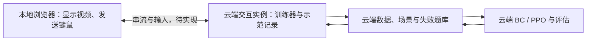

# 无桌面云端运行与低配开发端

更新：2026-11-26。默认条件：本地是无 GPU 的低配开发电脑；训练在无桌面的 Linux 云服务器，使用 NVIDIA GPU。用户确认可用 sudo，具体 GPU 型号、实例类型与图形能力待核验。

## 1. 默认分工

| 位置 | 承担的工作 | 当前状态 |
| --- | --- | --- |
| 本地开发电脑 | 编辑代码、Git、轻量测试、SSH、浏览器看画面和发送键鼠 | 不要求本地运行训练器、渲染地图或训练模型 |
| 云端游戏/交互实例 | 加载地图、真实画面渲染、执行人工或模型动作、记录示范、回合评估 | 现有 Linux 引擎可运行；GPU 图形环境和浏览器入口待接入验证 |
| 云端学习进程 | BC、PPO 更新、检查点、数据与失败题库 | 已有命令；主力云服务器尚未实际验收 |

优先让交互与训练放在同一台兼容的云服务器，按资源调度分别运行。若该实例只适合 CUDA 计算，则把游戏/交互放在另一台支持图形的云实例；现有 PPO 要在能运行引擎的实例上执行，仓库尚无跨主机 rollout 服务。离线 BC 可以单独放在计算实例。



无人训练时不依赖浏览器保持连接；人工领题时使用单独交互实例，避免和训练进程争抢控制权。初期可以暂停采样以腾出资源，不承诺单卡同时训练和串流仍保持满速。

## 2. 没有桌面图标仍然可以生成画面

服务器不需要完整桌面环境、物理显示器或人工点图标，但视觉智能体仍需要真实渲染输出。拟用与驱动兼容的后台显示/图形会话启动原生 Linux 游戏进程，再采集画面。具体配置由 GPU 型号、驱动和实例权限确定。

Godot 的 `--headless` 会禁用渲染；本项目只能用它导入资源，不能用来提供策略的 RGB 观察。依据：[Godot 官方 DisplayServer 说明](https://docs.godotengine.org/en/stable/classes/class_displayserver.html#description)。

当前 `scripts/run_linux.sh` 在没有 `DISPLAY` 时明确设置 `LIBGL_ALWAYS_SOFTWARE=1`，使用 Xvfb + CPU 软件渲染。它可以做功能自检，但没有自动完成云端 NVIDIA 图形配置。`doctor` 中 CUDA 可用也不等于图形或串流通过。正式长期 PPO 前必须检查实际引擎日志、画面和采样吞吐。

离线 `bc-train` 只读取已采集的图片与动作，本身不启动游戏，所以可以直接在纯命令行 Linux 上运行。

## 3. 云平台主要影响哪些条件

平台品牌不改变学习目标或 BC/PPO 算法。实际差别在于租用实例提供的能力：

| 条件 | 对项目的影响 | 需要核验的证据 |
| --- | --- | --- |
| 完整虚拟机/裸机，还是托管容器 | 决定能否配置驱动、后台显示和设备访问 | 实例说明、宿主机与容器的权限边界；容器 sudo 不等于宿主机权限 |
| GPU 型号和图形驱动 | CUDA 运算和 OpenGL 图形渲染需分别可用 | GPU 型号、驱动、引擎日志中的实际渲染设备、有效 RGB |
| 视频编码能力 | 影响浏览器画面的带宽、延迟和 CPU 开销 | 实际编码器测试；硬件编码不可用时另评估软件编码，不能只看显存 |
| 可访问的端口和转发方式 | 决定 HTTPS、WebSocket/WebRTC 等入口如何接通 | 平台端口映射、反向代理或受控隧道的实际可达性 |
| 持久磁盘和进程生命周期 | 避免关机/容器重建后示范与模型丢失 | 数据盘挂载与重启测试；SSH 断开后任务仍可运行 |

NVIDIA 官方把 `compute`、`utility`、`graphics`、`display`、`video` 分为不同驱动能力；容器默认通常只请求 `compute,utility`。因此 `nvidia-smi` 正常、PyTorch 能训练，都不能单独证明游戏渲染或编码可用。容器需按用途配置对应能力，具体取决于宿主机与运行时；不是在容器里随便加一个环境变量就能补齐宿主机缺失的支持。依据：[NVIDIA Container Toolkit](https://docs.nvidia.com/datacenter/cloud-native/container-toolkit/latest/docker-specialized.html)。

已确认 NVIDIA 和 sudo。准备实例时再取得具体 GPU 型号、驱动、实例类型及端口方式，不仅按“24–100 GB 显存”判断适配。通常可先查看：

```bash
nvidia-smi --query-gpu=name,memory.total,driver_version --format=csv
id
```

配置显示环境后再检查 OpenGL 与真实引擎画面。当前不提供未经目标机器验证的统一驱动安装或显示配置脚本。

## 4. 首批示范之前必须补齐的工作

1. **云端真实渲染验收**：同一地图与动作接口运行成功；日志确认实际 GPU 渲染设备；测单环境采样速度，不把本地软件渲染速度当云端结果。
2. **最小远程人工入口**：浏览器打开云端交互实例，能相对转头、移动、开枪、换弹、开始/重试/提交；失焦和断线释放输入。考虑复用 [Selkies 的 HTML5 串流与输入能力](https://docs.selkies.io/latest/components/web-client/)，当前尚未选定依赖或完成集成。
3. **网络条件下的数据对齐**：记录浏览器实际显示的帧、输入产生/到达/执行时刻；现有本地录制器的服务器侧时间戳不能自动代替浏览器显示时间。先验证回放与标签，延迟异常片段标记或排除。
4. **少量真人示范与云端 BC**：通过正常课程后，再扩大采集并训练；独立评估和异步纠错题库沿用现有接口。
5. **PPO 与实时验收**：在云端比较收益，随后单独处理未来 CPU/低配部署。当前开发电脑配置不等于最终运行硬件的性能结论。

本地录制窗口是可复用的现有工具，供有合适图形条件的机器或云端图形会话使用；不再要求当前开发电脑先完成游戏试玩和录制。浏览器控制现在是本项目首批远程人工数据的前置工作，完整任意时刻快照仍可后置。

浏览器的解码负载、网络和输入延迟仍需实测，可调整串流分辨率与帧率。仅把整个远程桌面展示出来可用于机制试操作；未验证帧与动作对齐前，不宣称已经得到可靠的 FPS 训练标签。训练 RPC 继续只监听 loopback，远程入口另设鉴权与连接管理。

## 5. 现有工程与新计划的边界

已实现：Linux 引擎接口、CPU 渲染回退、CLI 训练/评估、本地采集器、重放、BC/PPO、异步纠错题库。

尚未实现或验证：目标云端 GPU 显示配置、浏览器人工控制、网络帧/动作对齐，以及实际云实例的连续运行性能。本次更新修正分工与实施顺序，没有部署服务、开放端口或宣称串流已经可用。
