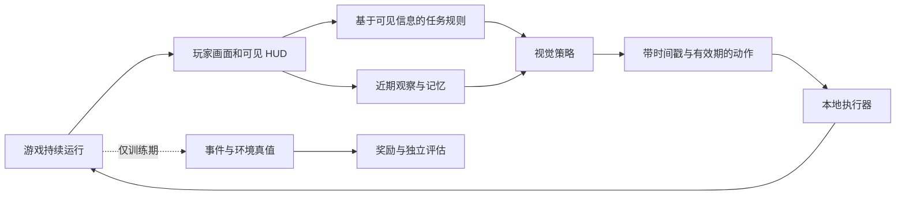

# 系统与训练架构

更新：2026-11-25。本文保留整体设计；0.2 版已实现的范围见[使用手册](../stage1-guide.md)，精确协议以[环境说明](../environment.md)为准。长期记忆、任务状态机和音频等条目仍为后续设计。返回[研究目录](README.md)。

## 1. 先把学习、任务规则和执行分开

采用“视觉策略负责操作、少量明确规则负责当前任务、执行器负责输入时序”的方案。规则可以表达“本回合去固定岗位”“已安装后转守包”，不能在运行时查询墙后敌人、全图坐标或未来事件来选择动作。

首版不用每帧调用通用聊天模型。候选是小型视觉网络加记忆层，输出移动、视角、射击和换弹。后续是否增加高级规划器，取决于基础模型暴露的具体短板。

图中真值没有连向运行策略。任务规则也必须遵守相同的信息边界。

## 2. 观察契约

| 数据 | 运行时允许范围 | 处理方式 |
|---|---|---|
| 第一人称画面 | 玩家当前能够看到的内容 | 固定预处理、尺寸与色彩；记录截图时刻 |
| 血量、弹药、回合与交互状态 | 画面实际显示的 HUD | 从像素识别或由视觉网络隐式使用；不拼接后台真值 |
| 小地图 / 大地图 | 当前玩家实际可见的内容 | 保留遮挡、标记时效和设置；是否首批启用需配置 |
| 历史与动作 | 自己过去看到的画面、自己发出和执行的动作 | 与回合边界对齐；过去位置带时间，不视为仍精确存在 |
| 任务指令 | 事先公开的固定路线、岗位、角色职责 | 可使用任务 ID；不能包含运行时隐藏敌人位置 |
| 游戏环境音 | 若实验明确启用的玩家可听声音 | 首批建议先做视觉基线，后续独立音频实验 |
| 内部坐标、全体敌人、碰撞体、事件真值 | 不进入执行策略 | 用于生成场景、奖励、诊断和离线统计 |

诊断接口里的 `info` 不是可随意拼接的观察。可以知道公开地图结构，但不能因此获得当前墙后人的真实位置。已安装提示只能更新“目标已安装”；没有可见位置依据时，包点保持未知。

固定 HUD、分辨率、灵敏度和按住/切换设置。0.2 版正式任务采用 256×144 RGB 与 4 帧历史；320×180 或局部裁剪留作识别精度对照。改变尺寸或视角动作时必须建立新契约，不能静默复用旧数据/权重。

## 3. 动作契约

候选动作包括前后、左右、水平/垂直视角变化、开火保持、换弹请求。基础课程先不要求跳跃、蹲伏、技能和复杂购买，但可以保留后续扩展字段。

每个动作必须注明：所属回合、依据的观察序号、生成时刻、有效时长，以及单位。视角可选择“这一时间段的总转角”或“角速度”；只能选定一种规范语义，适配器负责按实际时间转换。移动与视角允许同时进行。

0.2 版 MultiDiscrete 已增加两轴非均匀细分档位：±12、±4、±1、±0.25、0 度。录制保存实际执行的量化动作，也记录原始相对鼠标增量和增益；还不是高频原始鼠标事件轨迹。

一次性请求与保持状态分开：换弹不能因连续多个 tick 重复触发；开火和移动要保留按住/松开语义；回合结束、失焦、退出或动作超时应释放相应输入。最终“停止移动”的效果要看环境反馈，不只检查按键是否松开。

## 4. 步进训练与实时运行共用语义

lockstep 将多个模拟子步集中到一次请求；新增 realtime 在 Python 推理期间继续推进，最近动作超过 250 ms 未更新会释放。两者都由同一个 AgentTick 执行移动与武器。依据：[动作执行](../../engine/overlay/GameSession.AgentLab.cs)、[截帧与请求处理](../../engine/overlay/AgentBridge.cs)、[受控模式补丁](../../scripts/bootstrap.py)。

当前提供两种模式：

| 模式 | 时间如何推进 | 主要用途 |
|---|---|---|
| 精确步进 | 显式推进规定数量的模拟子步 | 调试、同步采样、确定性场景验证 |
| 实时运行 | 游戏按自己的时钟持续模拟和显示 | 实际演示、延迟测试、连续行为验收 |

二者共享运动、武器、输入映射与时间单位。实时模式不能靠录屏倍速或插帧假装闭环正常。跨模式评估时应记录动作延迟、重复时长和相机更新差异，必要时在训练中加入受控延迟扰动。

当前为 60 Hz 模拟、每动作 3 个子步，即目标 20 次决策/秒；真实频率取决于渲染与推理。显示 60 FPS 不等于每秒得到 60 个新决策。

## 5. 调度、记忆与过期动作

1. 截图时记录单调时钟和观察序号；推理取最新有效观察，不积压长队列。
2. 记忆状态沿处理过的观察序列单向更新；同一回合不允许多个异步调用乱序覆盖 LSTM 状态。
3. 执行器使用最新有效动作；旧动作短暂保持到新动作到达，但必须受有效期限制。
4. 回合结束立即失效化旧动作和未完成推理；新回合清空记忆与输入保持状态。
5. 延迟时记录真正应用的动作。训练日志不能把已经丢弃的请求当作环境执行过的样本。
6. 可对视角速度/加速度设合理限制，但强低通平滑会增加延迟；调整后必须重新做目标跟踪测试。

Physical Intelligence RTC 提醒了动作衔接与异步执行的重要性；这里使用的是工程问题分解，不声称已经实现其算法。[参考证据](reference-projects.md)

## 6. 模型与任务规则

当前基线：4 帧 RGB → 小型 CNN → 多个分类动作头，价值头用于 PPO；BC 与 PPO 共享策略权重。CNN/LSTM 或图像目标导航作为后续对照，以验证较长记忆是否改善遮挡、方向与任务恢复。

任务规则初期只做有限状态转换：前往岗位、跟随、交战、恢复原任务、目标交互、回合结束。交战优先级、回到哪一项任务和打断条件都要有明确记录。规则不提供直接瞄准坐标，不把后台敌人身份变成检测结果。

导航与射击可以先分任务采集示范、分课程训练，但目标是共享动作语义和可组合策略；不一开始搭建多套完整战术系统。若采用单独的视觉检测加规则控制器，标记为诊断基线或教师，不能把其表现报告成学习策略的成绩。

是否使用环境真值训练独立 critic 是后续对照项。默认先用真值做奖励和诊断，减少共享网络或特征拼接导致的信息泄漏。

## 7. 从既有代码扩展的落点

以下是模块责任划分，文件名不意味着功能已完成。

| 现有位置 | 后续责任 | 重点风险 |
|---|---|---|
| [AgentBridge.cs](../../engine/overlay/AgentBridge.cs) | 场景事件、观察时间戳、动作确认和协议版本 | 迟到消息跨回合、请求与实际执行不一致 |
| [GameSession.AgentLab.cs](../../engine/overlay/GameSession.AgentLab.cs) | 共用动作语义、细粒度视角、连续运行 | 不同 tick 下转角或武器节奏变化 |
| [NavigationMode.cs](../../engine/overlay/NavigationMode.cs) | 可重置课程、分阶段任务 | 上游模式自动重启绕过 Gym 结束信号 |
| [env.py](../../src/valorant_lab/env.py) | 观察/动作版本与错误处理 | 将诊断字段误作模型输入 |
| [cli.py](../../src/valorant_lab/cli.py) | 示范训练、纠错入口、分项评估与运行清单 | 旧模型加载了不兼容的动作映射 |
| [configs](../../configs) | 场景、任务与实验条件 | 口头约定没有进入版本化配置 |

## 8. 部署与领域迁移

后续控制后端可以替换，但应继续接收相同语义的动作，而不是让训练策略依赖某种硬件接口。替换后测输入延迟、视角增益、按住/松开和回合重置行为；仅更换输出接口不足以保证迁移。

模型与游戏在目标机器共同运行，避免每个控制周期依赖公网请求。低配部署阶段再做 ONNX 导出、量化、线程/算子优化或蒸馏，并验证动作、记忆与闭环任务一致性。图形渲染也需要资源，不能把“模型支持 CPU”写成“整个游戏不需要图形能力”。

对比真实目标环境时，逐项校准画面、HUD、地图版本、移动、后坐力、停止精度和控制延迟；先单项，后组合，最后才评价真实玩法效果。
