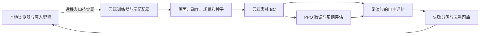

# 第一阶段使用手册

更新：2026-11-26。对应 0.2 版工程工具。目标是收集可靠数据、建立可复现的视觉行为基线；工程检查通过不代表模型已经学会游戏。默认使用低配本地开发端＋无桌面云端；浏览器人工入口待实现，已列为首批示范之前的工作，见[云端工作流](cloud-workflow.md)。

## 1. 先选课程

所有正式课程使用同一段 Lotus A Root → A 入口路线、Vandal、相同 HUD 和动作定义，便于组合示范。路线上的检查点不显示在画面里。角色从 A Root 出发，沿通道前进并向右调整路线，最终抵达 A 入口附近；交战结束后仍需继续前进。

| 配置 | 用途 | 对手与初始状态 |
| --- | --- | --- |
| `configs/lotus_route.json` | 先练正常行走 | 无敌人，小幅起点/朝向扰动 |
| `configs/lotus_shooting.json` | 行走、停稳射击、继续行走 | 一个不回击的固定敌人 |
| `configs/lotus_reload.json` | 换弹后完成原任务 | 不回击的固定敌人，初始空弹匣 |
| `configs/lotus_recovery.json` | 视角恢复后走路线 | 无敌人，初始仰角 60°、较大朝向扰动 |
| `configs/lotus_movement_combat.json` | 正式组合基线，命令默认配置 | 弱敌人会回击，生成概率 0.75，允许空回合 |
| `configs/lotus_navigation.json` | 工程连通性自检 | 约 4 米、青色立柱，旧动作定义；不混入正式示范 |

这些是起步课程，不是完整难例库。首次使用先确认鼠标方向、停稳、开火、弹药、换弹和路线正常，再扩大数据采集。完整官方机制校准尚未完成。

## 2. 低配开发端与云端如何配合



承担游戏/采集/训练的云端实例使用相同 Git 版本、地图、场景及控制契约。本地开发电脑只需编辑器、Git、轻量测试与 SSH/浏览器，不负责渲染地图。`local.json` 由实际运行游戏的机器生成，不能把 Windows 路径配置复制到 Linux。跨实例迁移时复制完整示范目录，模型 `.zip` 与同名 `.json` 一起保留。

离线 BC 不启动 Godot，因此只承担学习的 Linux 机器可以不安装图形显示环境。PPO、重放与评估需要游戏渲染，优先与学习器放在同一兼容云实例；当前命令尚未实现跨机器分布式 rollout。浏览器串流也尚未实现，本版现有入口是桌面录制窗口。根据当前本地硬件条件，需要先完成云端图形环境、浏览器控制和帧/动作对齐，再开始正式人工采集。

## 3. 现有桌面录制器的可选用法

以下命令用于具备图形会话和可用交互入口的机器，不是尚未实现的浏览器操作步骤，也不要求当前开发电脑运行。安装引擎、地图后执行：

```bash
pip install -e '.[collect]'
valorant-lab record --scenario configs/lotus_route.json \
  --episodes 5 --split train --seed 0
valorant-lab record --scenario configs/lotus_route.json \
  --episodes 2 --split validation --seed 0
```

Windows 原生安装命令见[服务器/本地说明](server.md)。Linux 图形会话可用 `valorant-lab record`；纯 SSH + Xvfb 看不到可操作窗口。当前项目先补齐云端串流入口，不再以本地试玩录制作为默认前提。

窗口操作：

- Space 开始，开始键释放后才允许作为跳跃输入。
- WASD 移动，Shift 静步，Ctrl 蹲，Space 跳跃。
- 鼠标转头、左键开火、R 换弹。
- Esc 放弃本回合；失焦会终止该段，避免遗留按键。
- 完成后 S 确认保存；R 重试；在准备/结果界面 Q 退出。

默认鼠标每像素对应 0.08° 的期望转角，再量化到模型同样的动作档位。可用 `--mouse-scale` 调整手感；原始相对鼠标增量和增益仍记入诊断。动作语义不变，模型学习实际执行的量化动作。

录制采用按目标动作周期节拍运行的 lockstep：图像与动作对应明确，低性能渲染可能使游玩变慢。它不等于实时性能验收；实时成绩由 `evaluate --realtime` 单独给出。

按相同方法采集射击、换弹、恢复和正式组合课程。上述数字只是试采示例。各次运行换不同 `--seed` 索引，避免重复采集同一题。训练/验证使用不同种子区间，同一具体场景/种子不得跨组。

## 4. 数据内容和验收

每段示范在 `runs/demonstrations/episode-…/`：

- `episode.json`：来源、分组、场景、种子、任务及动作契约、质量标记、分块哈希、是否确认采用。
- `chunk-*.npz`：动作之前的 RGB 与随后执行的 8 维动作，最多 64 个样本一块；不保存可执行 pickle。
- `diagnostics.jsonl`：帧号、模拟状态、时间和原始鼠标增量，仅用于检查。

学习器只读取图片和动作。它在每个回合开始补 3 张零帧，再堆叠当前帧；不会跨回合拼接历史，也不会读取 `info` 作为输入。数据按块读取，不要求把全部录屏塞进内存。

只有完整、成功、人工确认、质量检查通过的示范进入普通 BC。失败回合仍可保留用于分析，但不会自动把错误动作当正确标签。`script_test` 仅供管线测试，普通训练拒绝使用。

选一段重放：

```bash
valorant-lab replay --episode runs/demonstrations/episode-实际编号 \
  --output runs/replay-check --paced
```

重放从原始种子开始执行动作，检查位置、弹药、击杀数和路线进度。`replay.json` 给出差异步；不要求跨平台画面逐像素一致，也不提供任意时刻状态恢复。出现明显差异先检查版本与数据，暂停扩大采集。

## 5. 云端 BC 与评估

确认训练实例能访问已验收的完整示范目录后执行；默认数据在云端采集，跨实例时再复制：

```bash
valorant-lab bc-train --data runs/demonstrations \
  --device cuda --epochs 10 --output runs/bc
bash scripts/run_linux.sh evaluate --model runs/bc/best.zip \
  --split dev --episodes 10 --queue runs/corrections \
  --output runs/bc-dev
```

`best.zip` 按验证集动作损失选择；`latest.zip` 是最后一个 epoch。`metrics.json` 报告训练损失、验证损失和各动作维度准确率。低损失、较高的“无操作”准确率均不能代替自主游玩评估。

本版使用小型 CNN 与 4 帧历史，BC 与 PPO 共享特征和动作头。还没有 GRU/LSTM 的长期记忆，也未使用大语言模型逐动作推理。

评估产物包括 `report.json`、每回合轨迹、开始/结束图片。加 `--save-frames` 保存每次响应画面及对应时间，便于检查全过程；目前没有自动打包为 MP4，不能把等间隔拼帧当作原速证据。

## 6. 系统怎样给你出纠错题

```bash
valorant-lab queue --queue runs/corrections
valorant-lab record --case runs/corrections/实际编号/case.json \
  --output runs/demonstrations
```

题目按反复发生的位置区域、当前路线阶段与失败类别合并。第一版识别持续仰视/俯视、疑似顶墙、空弹未换、交战死亡、跌落和路线未完成。静止本身不判卡住；顶墙候选要求曾持续请求移动。

它们是待检查的候选题，检测器可能误报。任务包含失败截图、诊断片段和明确的公开目标。你只需领取题目，从回合起点完成任务，成功后确认保存。当前不是恢复到卡死那一瞬间，后续才考虑完整快照。

示范被采用后题目状态为 `demonstrated`；训练后可复测：

```bash
bash scripts/run_linux.sh evaluate --model runs/bc/best.zip \
  --case runs/corrections/实际编号/case.json \
  --output runs/case-recheck
```

一次通过记为 `model_passed_once`，并绑定模型哈希；它不代表在所有变体中都已解决。正式 test 不生成纠错任务；开发题被补课后，分数属于开发成绩。普通示范与纠错示范混合训练，避免只会脱困或遗忘正常行为。

## 7. PPO 微调、恢复和周期评估

```bash
bash scripts/run_linux.sh train --init-bc runs/bc/best.zip \
  --device cuda --steps 100000 --eval-every 25000
bash scripts/run_linux.sh train --resume runs/ppo-movement-combat/latest.zip \
  --device cuda --steps 100000
```

`--init-bc` 复制 BC 策略权重并建立新的 PPO 优化器；`--resume` 恢复已有 PPO。二者互斥。人工动作仅用于 BC，不混入 PPO 的 on-policy rollout 冒充模型动作。此版没有在线 HG-DAgger 或人类随时接管 PPO 的算法实现。

周期评估使用独立游戏进程，失败题写在训练输出目录的 `corrections/`。先单环境运行，再按渲染吞吐和显存增加 `--envs`。任务没有进步时先分析失败、数据与奖励，不靠无限增加训练时长。

## 8. 正常速度验收

```bash
bash scripts/run_linux.sh evaluate --model runs/ppo-movement-combat/latest.zip \
  --split test --realtime --episodes 10 --output runs/realtime-test
```

实时模式从第一条动作开始持续运行模拟，推理耗时期间沿用最近动作；超过 250 ms 未收到控制更新会释放动作。报告包含模拟/墙钟时间比、丢弃的时间、保护性释放次数、推理 p95 与观察间隔 p95。

当前工程时序门槛：模拟/墙钟比至少 0.9、丢时低于 50 ms、无保护性释放、推理 p95 不超过动作周期、观察间隔 p95 不超过两个动作周期；还必须完成任务才计 `realtime_task_pass`。这些是初始检查线，不能作为人类主观流畅度的唯一标准。软件渲染跑不满时必须如实失败。

近期前置工作是云端 GPU 渲染、浏览器串流与输入/画面对齐。能力扩展包括自然地标目标导航、更长历史记忆、移动敌人、更多路线变体、友军和爆破状态机、任意时刻快照、声音和低配部署。研究理由见[人工纠错与训练路线](research/human-correction-plan.md)。
